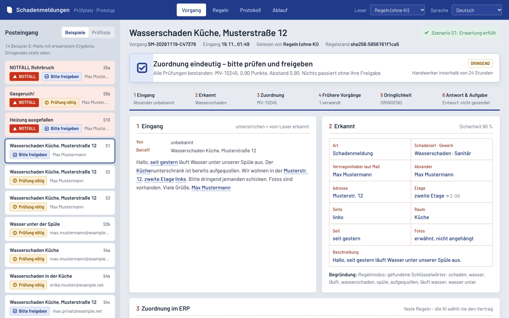
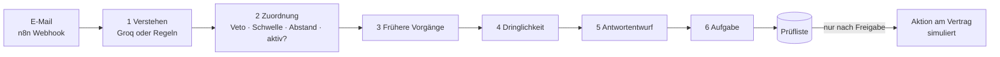
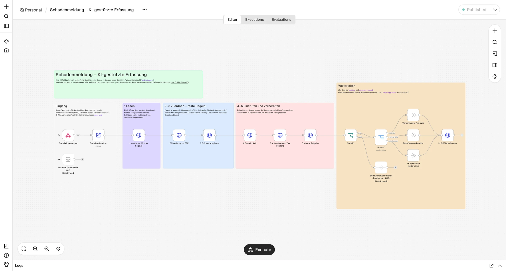

# KI-gestützte Verarbeitung von Schadenmeldungen – Prototyp

Praxisaufgabe für Inovidus GmbH · Mithulram Gunasekaran · November 2026

> **Die KI liest. Feste Regeln entscheiden. Ein Mensch handelt.**
> Eine Mieter-E-Mail wird in sechs Schritten zu einem geprüften Vorgang – mit Begründung für jede Entscheidung. Ist etwas unklar, rät das System nicht, sondern sagt **„Prüfung nötig“**. Nichts wird automatisch gesendet.



## In 3 Befehlen starten

Voraussetzung: [uv](https://docs.astral.sh/uv/) (lädt Python 3.12 automatisch). Kein API-Schlüssel nötig.

```bash
uv sync                    # Abhängigkeiten installieren
uv run intake-scenarios    # alle 14 Testfälle prüfen (Tabelle)
uv run intake-ui           # Prüfplatz öffnen: http://127.0.0.1:8000
```

Weitere Befehle: `uv run pytest` (alle Tests) · `uv run intake process scenarios/S01_original.yaml` (ein Fall als JSON).
Mit KI: `.env.example` nach `.env` kopieren, `GROQ_API_KEY` eintragen, im Prüfplatz oben „Leser: Groq · live“ wählen. Ohne Schlüssel: „Groq · Aufzeichnung“ zeigt echte, aufgezeichnete Groq-Antworten.

## Online-Demo (Render, kostenlos)

**Live:** Prüfplatz https://inovidus-intake.onrender.com · n8n https://inovidus-n8n.onrender.com (Zugangsdaten auf Anfrage).

`render.yaml` beschreibt zwei Dienste: den Prüfplatz (App + API) und n8n. Beide sind geschützt:
- Prüfplatz: Passwort-Abfrage im Browser (Benutzername beliebig, Passwort = `INTAKE_ACCESS_PASSWORD`, von Render erzeugt).
- n8n: eigenes Konto (wird beim Start aus Render-Geheimnissen angelegt); der Webhook braucht den Header `X-Webhook-Token`.
- Kostenloser Tarif: nach Inaktivität schlafen die Dienste ein, der erste Aufruf dauert dann ca. 30–60 Sekunden. Gespeicherte Vorgänge werden bei einem Neustart zurückgesetzt (nur Testdaten).

## Was die Lösung mit der Beispiel-E-Mail macht

| Schritt | Ergebnis |
|---|---|
| Erkennen | Schadenmeldung · Wasserschaden · Gewerk Sanitär |
| Herauslesen | Max Mustermann · „Musterstr. 12“ · „zweite Etage“ → 2. OG · „links“ → li. · Küche · seit gestern · Fotos erwähnt, nicht angehängt |
| Zuordnen | **MV-10245** mit 0,90 Punkten. **MV-10487 ausgeschlossen:** „Etage widerspricht: 2. OG ≠ 3. OG“ |
| Frühere Vorgänge | „Rohrverstopfung Küche“ (gleiche Einheit, gleicher Raum) → **möglicher Zusammenhang**, nur intern |
| Dringlichkeit | **DRINGEND** (Wasser tritt aus, Folgeschaden sichtbar) → Handwerker innerhalb 24 Std. – „bitte dringend“ allein erhöht nicht |
| Antwort | Entwurf: Eingang bestätigt, Frist genannt, Fotos angefordert – **wird nie automatisch gesendet** |
| Aufgabe | Sanitär-Handwerker beauftragen, Hausmeister informieren, Zusammenhang mit Rohrverstopfung prüfen (ggf. Gewährleistung) |
| Status | **„Bitte freigeben“** – erst nach Freigabe (Name, Zeit) passiert etwas am Vertrag |

Beispielausgaben: [examples/](examples/) (JSON, Antwortentwurf, Aufgabe).

## Testfälle (Fachregeln, die sich im Gespräch ändern können)

| # | Fall | Ergebnis |
|---|---|---|
| S1 | Original-E-Mail | MV-10245, bitte freigeben, DRINGEND |
| S2 | ohne „zweite Etage links“ | Prüfung nötig: zwei Verträge gleich gut – Antwort fragt nach Etage und Seite |
| S3 | MV-10245 inaktiv | Prüfung nötig – **kein Ausweichen** auf MV-10487 |
| S3b | inaktiver + aktiver Vertrag auf gleicher Etage, Seite fehlt | Prüfung nötig (Abstand) |
| S4a/b/c | Name anders geschrieben / Partnerin schreibt / unbekannte Absenderadresse | Prüfung nötig / Prüfung nötig / freigeben **mit Warnung** und 3 Optionen |
| S5a/b | Rohrbruch / Gasgeruch ohne Wohnung | NOTFALL mit Sicherheitshinweisen; bei Gas: Gebäude-Notdienst erlaubt, Vertrag nicht |
| S6 | Frage zur Miete | keine Schadenmeldung → Mietbuchhaltung |
| S7 | Englisch, „2nd floor“ | Antwort auf Englisch; Etage nachfragen (britisch 2. OG, US 1. OG) |
| S8/S9 | Schwelle auf 0,65 gesenkt | anderes Gebäude / fehlende Etage → trotzdem Prüfung (Veto bzw. Etage fehlt) |
| S10 | Heizung aus im November | NOTFALL (Heizperiode) |

Neuer Fall = neue Datei in `scenarios/`. Regel ändern = eine Zeile in `config/rules.yaml`, dann im Prüfplatz „Regeln → Alle Beispiele neu prüfen“.

## Architektur in Kürze



Der **n8n-Workflow** zeigt den Ablauf (ein Knoten pro Schritt). n8n leitet nur weiter – die Entscheidungen trifft der Python-Dienst nach `config/rules.yaml`.



## Unterlagen (Erwartetes Ergebnis)

| Gefordert | Wo |
|---|---|
| Funktionsfähiger Prototyp / Workflow | dieser Ordner · `uv run intake-ui` · [workflows/n8n_schadenmeldung.json](workflows/n8n_schadenmeldung.json) ([Anleitung](workflows/README.md)) |
| Quellcode / Workflow-Export | [src/intake/](src/intake/) · [workflows/](workflows/) · Bildschirmfotos: [docs/screenshots/](docs/screenshots/) |
| Beispielhafte Ausgabe | [examples/](examples/) |
| Architektur | [deliverables/02_Architektur.md](deliverables/02_Architektur.md) |
| Priorisierung und Entscheidungen | [deliverables/01_Priorisierung_und_Entscheidungen.md](deliverables/01_Priorisierung_und_Entscheidungen.md) |
| Was funktioniert, Risiken, Produktion | [deliverables/03_Einschaetzung.md](deliverables/03_Einschaetzung.md) |
| Wiederverwendung für einen Wissensassistenten | [deliverables/04_Wiederverwendung_Wissensassistent.md](deliverables/04_Wiederverwendung_Wissensassistent.md) |
| KI-Nutzung | [deliverables/05_KI_Nutzung.md](deliverables/05_KI_Nutzung.md) |
| Tatsächlicher Aufwand | [deliverables/06_Aufwand.md](deliverables/06_Aufwand.md) |

---

## English summary

A prototype that turns a tenant's damage-report email into a checked, explainable case. **The LLM only reads** (classification, extraction, urgency hint – Groq `openai/gpt-oss-120b` with strict JSON schema, or a rule-based reader with no API key). **Deterministic rules decide** the ERP match: per-signal points (name, address, floor, side, contact), contradictions veto a candidate regardless of threshold, then threshold + margin, then an active-contract check that never falls back to another contract. Anything unclear becomes `NEEDS_REVIEW`. **A human acts**: every contract-level action goes through one approval handler and an append-only audit log; there is no send function anywhere.

Stack: Python 3.12, Pydantic, FastAPI, rapidfuzz, a hand-built review UI (no framework, offline), n8n 2.x for the visible workflow (one HTTP node per step, parity-tested against the single-call API). 14 business scenarios with exact expected outcomes, 550+ tests. All business rules live in `config/rules.yaml`.

Run: `uv sync && uv run intake-scenarios && uv run intake-ui`. The UI has a language switch (Deutsch / English / English + Deutsch); English mode translates every system text, the tenant reply stays in the e-mail's language. English versions of all deliverables: [deliverables/en/](deliverables/en/).

Hosted demo – live: https://inovidus-intake.onrender.com (review desk) and https://inovidus-n8n.onrender.com (n8n); credentials on request. Render free tier, `render.yaml`: app behind a generated password, n8n with an owner account and a token-protected webhook, both created from Render-generated secrets; services sleep when idle (first request ~30–60 s).
