# Rundgang durch den Prototyp

Eine Mieter-E-Mail wird in sechs Schritten zu einem geprüften Vorgang:
**Eingang → Erkennen → Zuordnen → Frühere Vorgänge → Dringlichkeit → Antwort & Aufgabe.**
Die KI liest nur. Feste Regeln ordnen den Vertrag zu. Ein Mensch gibt frei. Nichts wird automatisch gesendet.

Ausprobieren: https://inovidus-intake.onrender.com (Benutzer `demo`, Passwort `demo`).
Die Zahlen in den Bildern gehören zu den Listen darunter.

---

## Mein Schwerpunkt

Aus eurer Aufgabe habe ich vier Schwerpunkte abgeleitet:

1. **Eine unklare Zuordnung darf nie zu einer Aktion am falschen Vertrag führen.** Die Beispieldaten haben genau diese Falle:
   Max Mustermann hat zwei aktive Verträge im selben Haus. Nur „zweite Etage links“ entscheidet.
2. **Jede Entscheidung muss man erklären können** – auch jemandem, der nicht programmiert.
3. **Regeln werden im Gespräch geändert.** Darum stehen alle fachlichen Regeln in einer Datei, und alle Beispiele lassen sich mit einem Klick neu prüfen.
4. **Der Antwortentwurf wird nie automatisch gesendet.**

Deshalb habe ich Zeit in die Zuordnung, die Begründungen und die Freigabe gesteckt – nicht in Dinge wie Wiedervorlage,
Benutzerrollen, Foto-Analyse oder eine echte Postfach- und ERP-Anbindung. Diese stehen als nächste Schritte in
[03_Einschaetzung.md](03_Einschaetzung.md).

## Die Testdaten (Beispiel-ERP)

Das ERP ist eine JSON-Datei (`data/erp_contracts.json`). MV-10245, MV-10487 und der frühere Vorgang „Rohrverstopfung Küche“
kommen aus eurer Aufgabe. Die übrigen Datensätze habe ich ergänzt, damit man typische Fehler zeigen kann.

| Vertrag | Mieter | Adresse | Lage | Wozu |
|---|---|---|---|---|
| MV-10245 | Max Mustermann | Musterstraße 12 | 2. OG links | aus der Aufgabe |
| MV-10487 | Max Mustermann | Musterstraße 12 | 3. OG rechts | aus der Aufgabe – gleicher Name, gleiches Haus |
| MV-10112 | Erika Musterfrau | Musterstraße 12 | EG rechts | Nachbarin im selben Haus |
| MV-10530 | Jonas Beispiel | Musterstraße 14 | 2. OG links | Haus nebenan – falsche Hausnummer muss auffallen |
| MV-10601 | Maximilian Muster | Beispielweg 7 | 1. OG links | ähnlicher Name, andere Adresse |
| MV-10715 | Mithulram Gunasekaran | Musterstraße 15 | 2. OG links | eigener Testmieter für Live-Tests |

Frühere Vorgänge (`data/cases.json`): VG-2026-0412 „Rohrverstopfung Küche“ (MV-10245) und VG-2026-0377 „Fenster undicht Wohnzimmer“ (MV-10487).

---

## 1 Überblick

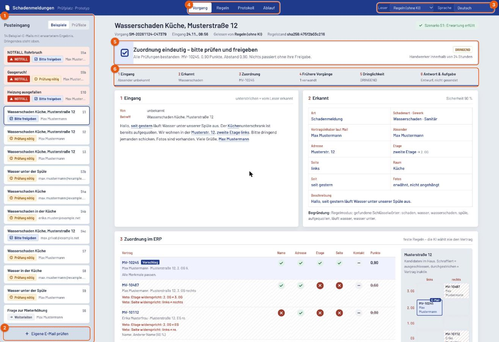

1. **Posteingang** – 14 Beispiel-E-Mails mit erwartetem Ergebnis. Notfälle stehen oben. Reiter *Prüfliste*: E-Mails, die über n8n hereinkamen.
2. **Eigene E-Mail prüfen** – eine eigene Nachricht eintippen (siehe Abschnitt 7).
3. **Leser und Sprache** – *Regeln (ohne KI)*, *Groq · live* oder *Groq · Aufzeichnung*; Oberfläche auf Deutsch, Englisch oder beides.
4. **Ansichten** – Vorgang, Regeln, Protokoll, Ablauf (n8n).
5. **Ergebnis in einem Satz** – hier: Zuordnung eindeutig, MV-10245, 0,90 Punkte, DRINGEND.
6. **Die sechs Schritte** – mit dem Kurzergebnis jedes Schritts. Ein Klick springt zum Abschnitt.

## 2 Eingang und Erkennen

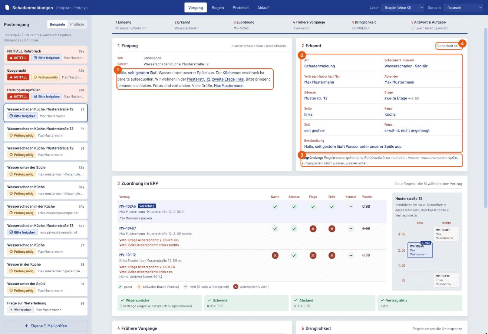

1. **Original-E-Mail** – unterstrichen ist, was der Leser erkannt hat. So sieht man sofort, woher jede Angabe kommt.
2. **Erkannte Fakten** – Art, Schadenart, Gewerk, Name, Adresse, Etage, Seite, Raum, seit wann, Fotos, Beschreibung.
   „zweite Etage“ wird nach deutscher Zählweise zu **2. OG**.
3. **Begründung** – welche Wörter zur Einstufung geführt haben.
4. **Sicherheit** des Lesers in Prozent.

## 3 Zuordnung zum Vertrag

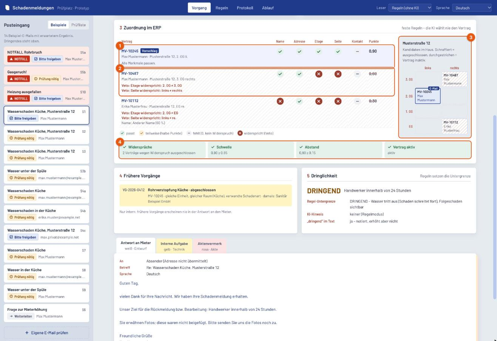

Feste Regeln vergeben Punkte je Merkmal: **Name 0,30 · Adresse 0,30 · Etage 0,20 · Seite 0,10 · Kontakt 0,10.**

1. **MV-10245** – Name, Adresse, Etage und Seite passen (0,90 Punkte); eine Kontaktangabe fehlt, das gibt 0, aber keinen Widerspruch → Vorschlag.
2. **MV-10487** – gleicher Name, gleiches Haus, aber Etage und Seite **widersprechen** → ausgeschlossen (Veto), egal wie viele Punkte.
3. **Hausansicht** – wo die Kandidaten wohnen und wohin die E-Mail zeigt.
4. **Vier Prüfregeln** – nur wenn alle grün sind, gibt es einen Vorschlag:
   keine Widersprüche · Punkte ≥ 0,85 · Abstand zum Zweitbesten ≥ 0,15 · Vertrag aktiv.

**Die KI wählt nie den Vertrag.** Das ist Absicht: Die Zuordnung muss immer gleich, nachrechenbar und erklärbar sein.

## 4 Frühere Vorgänge, Dringlichkeit und die drei Blätter

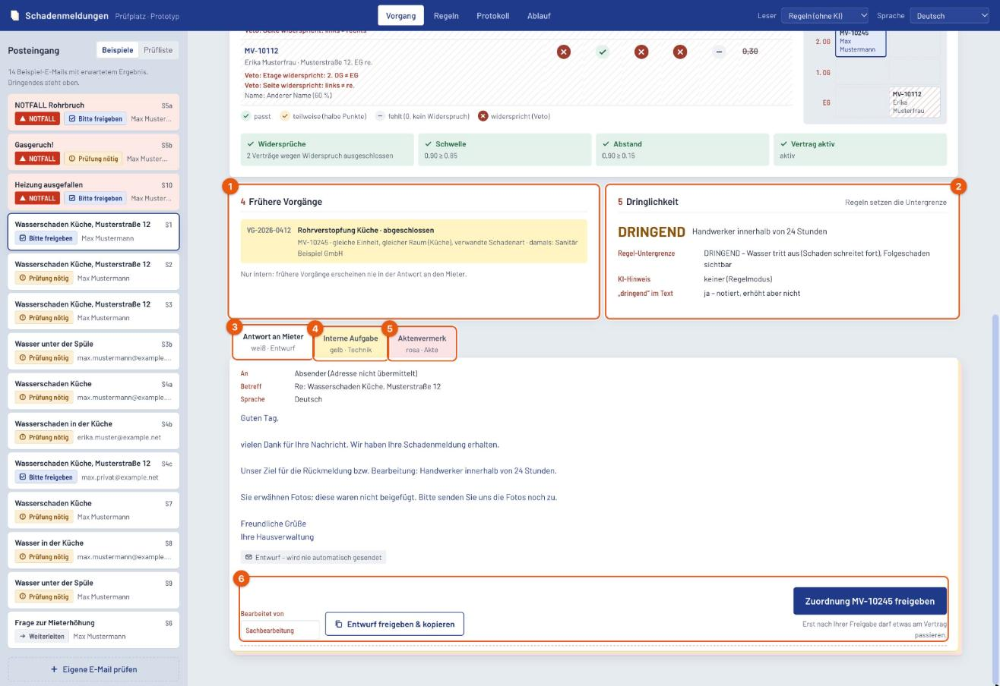

1. **Frühere Vorgänge** – „Rohrverstopfung Küche“, gleiche Wohnung, gleicher Raum → möglicher Zusammenhang. Nur intern, nie in der Antwort.
2. **Dringlichkeit** – Regeln setzen die Untergrenze (hier DRINGEND: Wasser tritt aus, Folgeschaden sichtbar). Die KI darf nur erhöhen, nie senken.
   „Bitte dringend“ im Text wird notiert, erhöht aber nicht – sonst wäre jede Mail dringend.
3. **Weißes Blatt** – Antwortentwurf an den Mieter, in seiner Sprache. Wird nie automatisch gesendet.
4. **Gelbes Blatt** – interne Aufgabe für die Technik.
5. **Rosa Blatt** – Aktenvermerk mit Protokoll und JSON.
6. **Freigabe-Bereich** – erst nach Klick passiert etwas.

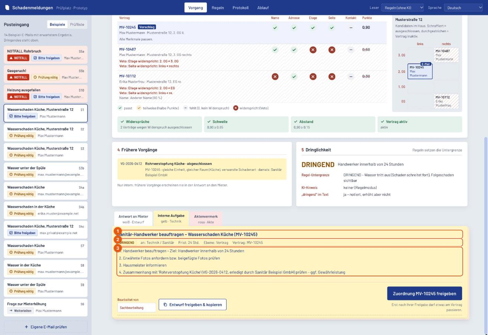

1. **Aufgabe** – Sanitär-Handwerker beauftragen, mit Vertrag.
2. **Rahmen** – Dringlichkeit, zuständige Stelle, Frist (24 Std.), Ebene (Vertrag).
3. **Checkliste** – u. a. Fotos anfordern und den früheren Vorgang prüfen (evtl. Gewährleistung).

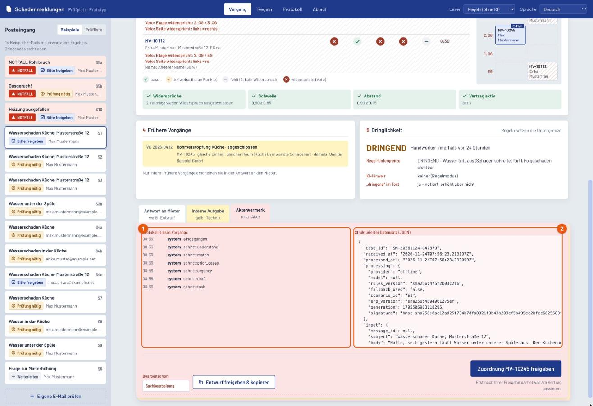

1. **Protokoll dieses Vorgangs** – jeder Schritt mit Uhrzeit.
2. **Strukturierter Datensatz (JSON)** – alles, was ein ERP oder ein Workflow weiterverarbeiten kann. Gekürzt:

```json
{
  "case_id": "SM-20261118-C47379",
  "status": "READY_FOR_APPROVAL",
  "understanding": { "classification": { "type": "SCHADENMELDUNG", "category": "Wasserschaden", "trade": "Sanitär" },
                     "extraction": { "tenant_name": "Max Mustermann", "street_raw": "Musterstr.", "house_no": "12",
                                     "floor_raw": "zweite Etage", "side_raw": "links", "room": "Küche" } },
  "match": { "selected_contract": "MV-10245", "score": 0.9, "margin": 0.9, "failed_gates": [] },
  "urgency": { "level": "DRINGEND", "response_target": "Handwerker innerhalb von 24 Stunden" },
  "reply_draft": { "language": "de", "subject": "Re: Wasserschaden Küche, Musterstraße 12" },
  "internal_task": { "title": "Sanitär-Handwerker beauftragen – Wasserschaden Küche (MV-10245)" }
}
```
Vollständige Beispiele: `examples/S1_regelmodus.json` (ohne KI) und `examples/S1_groq_aufzeichnung.json` (mit KI).

## 5 Freigabe

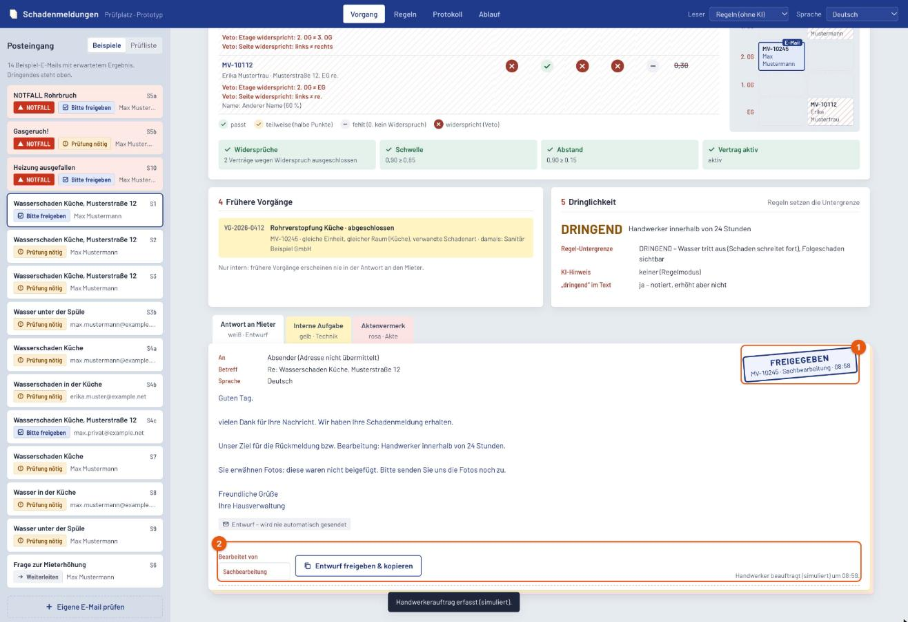

1. **Stempel „Freigegeben“** – mit Vertrag, Person und Uhrzeit.
2. **Nächste Schritte** – *Entwurf freigeben & kopieren* legt den Text in die Zwischenablage (Versand bleibt beim Menschen).
   *Handwerker beauftragen* ist im Prototyp simuliert – es gibt keinen Schreibzugriff aufs ERP.

## 6 Wenn es unklar ist (Beispiel S2)

Gleiche E-Mail, aber ohne „zweite Etage links“.

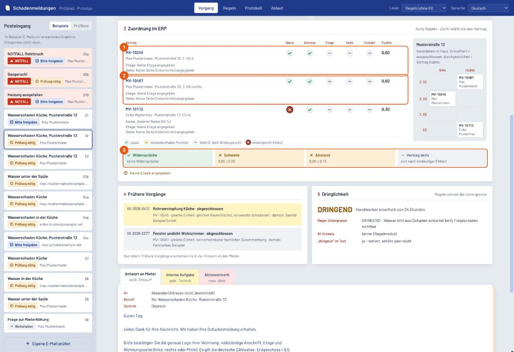

1. und 2. **Beide Verträge haben 0,60 Punkte** – keiner widerspricht, keiner ist eindeutig.
3. **Prüfregeln** – Schwelle und Abstand nicht erreicht → **Prüfung nötig**. Das System rät nicht.

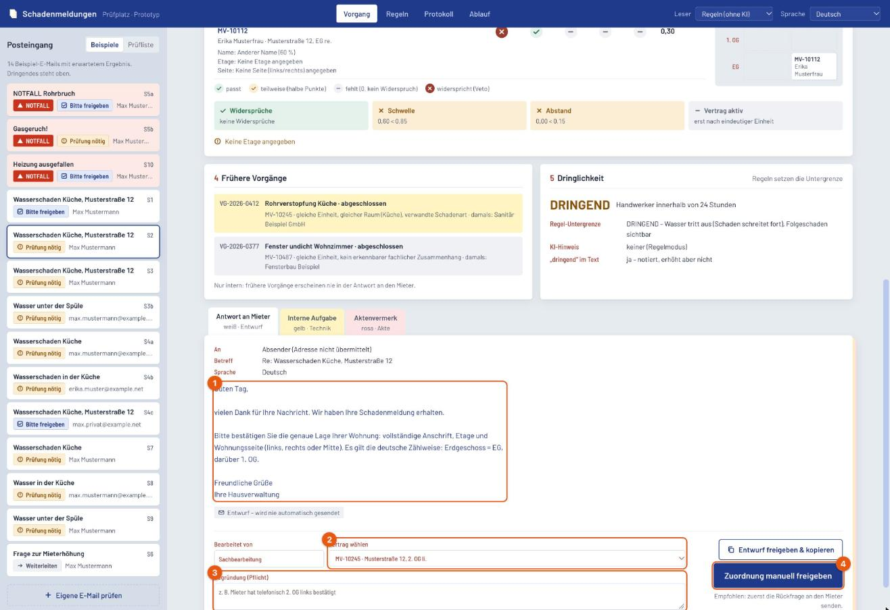

1. **Antwortentwurf fragt nach** – vollständige Anschrift, Etage, Seite (mit Erklärung der deutschen Zählweise).
2. **Vertrag wählen** – die Sachbearbeitung kann selbst zuordnen …
3. **Begründung (Pflicht)** – … muss aber begründen, z. B. „Mieter hat telefonisch 2. OG links bestätigt“.
4. **Manuell freigeben** – die Begründung steht danach im Protokoll.

## 7 Eigene E-Mail testen

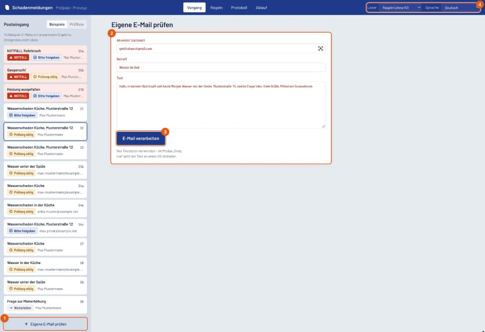

1. **Eigene E-Mail prüfen** (unten links).
4. Vorher oben den **Leser** wählen: ohne KI oder mit Groq.
2. **Absender, Betreff, Text** eingeben.
3. **E-Mail verarbeiten.**

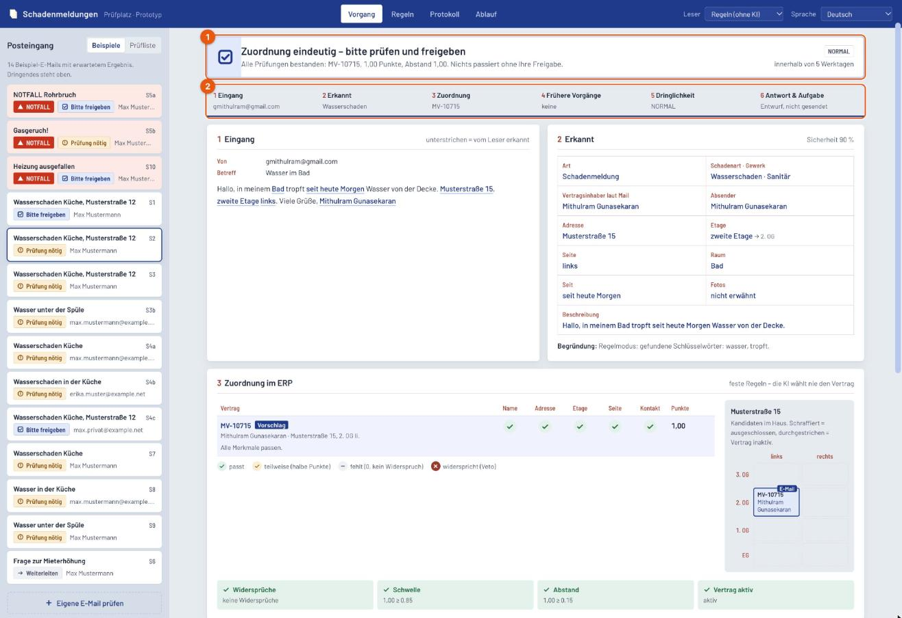

1. Ergebnis: **MV-10715**, 1,00 Punkte – alle Merkmale passen.
2. Die sechs Schritte wie bei den Beispielen.

Tipp zum Ausprobieren: „zweite Etage links“ weglassen → Prüfung nötig. Eine andere Hausnummer schreiben → Widerspruch.
Auffällig hier: „tropft von der Decke“ ergibt nur NORMAL, weil die Regeln „von der Decke“ noch nicht kennen.
Das ist eine Zeile in `config/rules.yaml` – genau so eine Änderung zeige ich gern im Gespräch.

## 8 Regeln ändern und alles neu prüfen

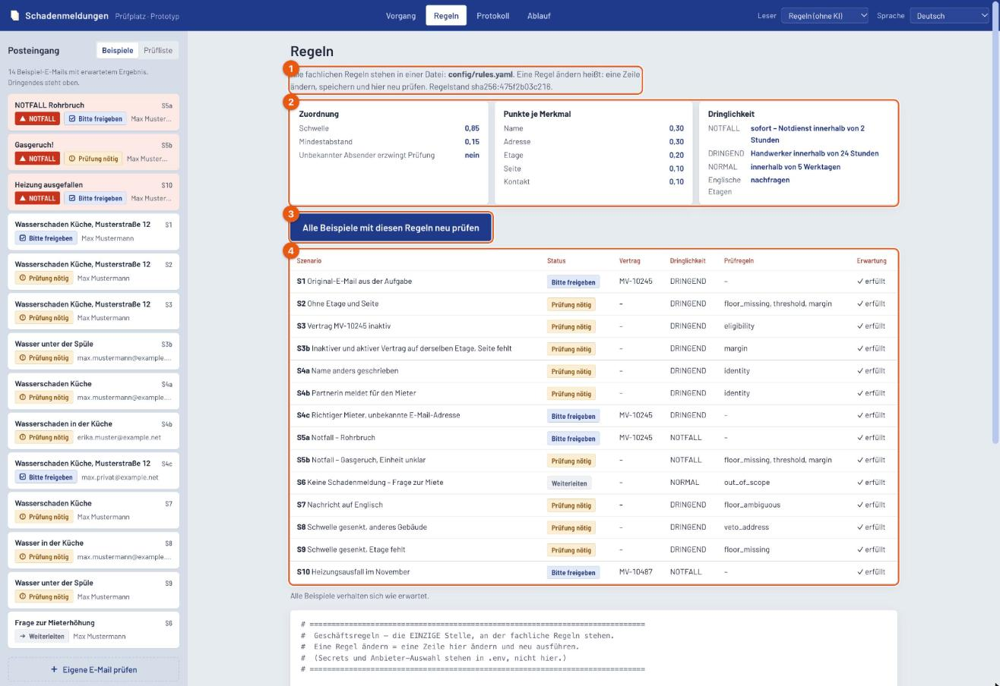

1. **Eine Datei für die fachlichen Werte** – `config/rules.yaml` (Punkte, Schwellen, Dringlichkeit, Schlüsselwörter). Eine Regel ändern heißt: eine Zeile ändern und speichern.
2. **Wichtigste Werte** – Schwelle, Mindestabstand, Punkte je Merkmal, Reaktionszeiten je Dringlichkeit.
3. **Alle Beispiele neu prüfen** – ein Klick.
4. **Ergebnis je Beispiel** – Status, Vertrag, Dringlichkeit, verletzte Prüfregeln, Erwartung erfüllt oder nicht.
   Wenn eine Regeländerung ein Beispiel anders ausgehen lässt, sieht man es hier sofort.

**Wo gilt die Änderung?**
- **Lokal** (`uv run intake-ui`): `config/rules.yaml` ändern und speichern – gilt sofort, ohne Neustart und ohne Deployment.
- **Online-Version:** `config/rules.yaml` ändern, speichern und die Anwendung neu deployen – erst dann gilt die Änderung.

## 9 Protokoll

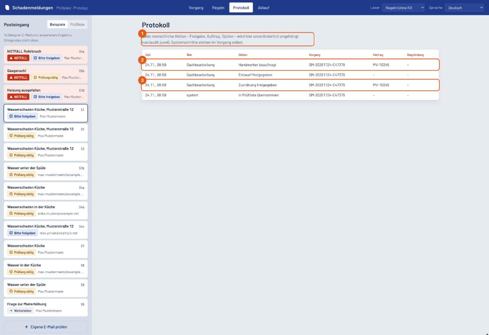

1. **Jede menschliche Aktion** wird angehängt und nicht mehr verändert (`var/audit.jsonl`).
2. **Handwerker beauftragt** – wer, wann, welcher Vorgang, welcher Vertrag.
3. **Zuordnung freigegeben** – bei manueller Zuordnung steht hier auch die Begründung.

## 10 Der Ablauf in n8n

n8n zeigt den Prozess sichtbar: ein Knoten pro Schritt. **n8n leitet nur weiter – entschieden wird im Python-Dienst nach den Regeln.**

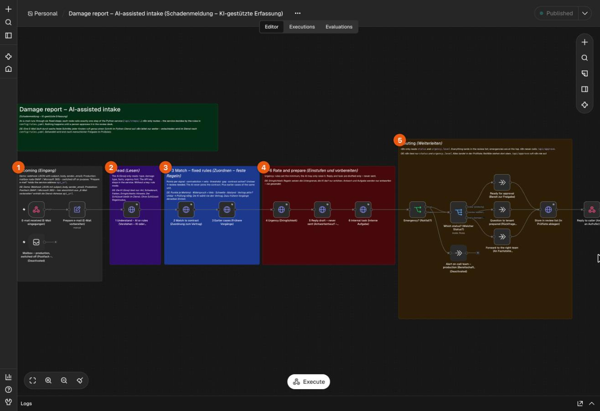

1. **Eingang** – Webhook für die Demo (geschützt mit Token). Daneben das Postfach für die Produktion (absichtlich aus).
2. **Lesen** – Schritt 1, KI oder Regeln.
3. **Zuordnen** – Schritte 2 und 3, feste Regeln und frühere Vorgänge.
4. **Einstufen und vorbereiten** – Dringlichkeit, Antwortentwurf, interne Aufgabe.
5. **Weiterleiten** – Notfall? Welcher Status? Alles landet in der Prüfliste; Notfälle stehen oben.

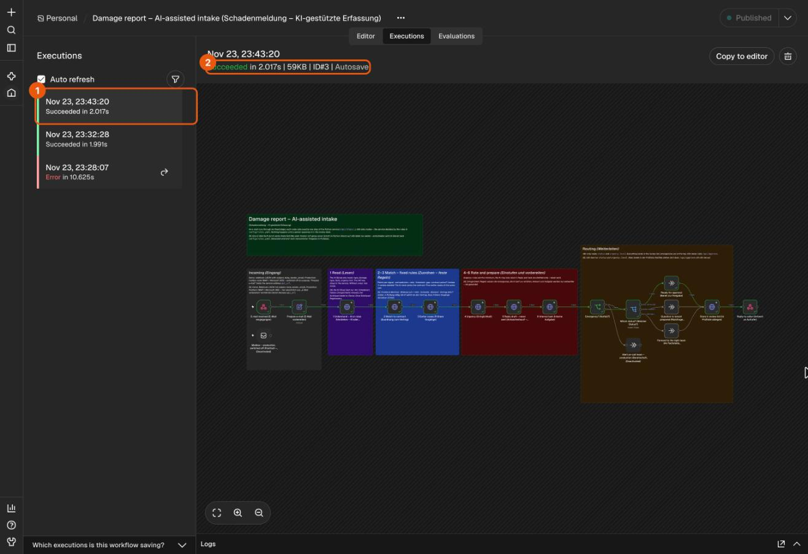

1. **Ausführungen** – jede eingegangene E-Mail ist ein Lauf.
2. **Ergebnis des Laufs** – grün = alle Schritte erfolgreich. Der Vorgang erscheint danach im Prüfplatz unter *Prüfliste*.

---

## Kurze Antworten auf naheliegende Fragen

**Warum wählt nicht die KI den Vertrag?** Weil die Zuordnung immer gleich, nachrechenbar und erklärbar sein muss. Die KI liest
nur die E-Mail; den Vertrag wählen feste Regeln. Ein Irrtum der KI kann so höchstens zu „Prüfung nötig“ führen.

**Was passiert, wenn zwei Verträge gleich gut passen?** Status „Prüfung nötig“, der Antwortentwurf fragt beim Mieter nach.
Ein Mensch kann selbst zuordnen – aber nur mit Begründung (Abschnitt 6).

**Was, wenn Groq nicht erreichbar ist?** Dann liest sofort der Regelmodus (bei ungültiger KI-Antwort erst nach einem neuen Versuch).
Nennt die KI eine Adresse, Etage oder Seite, die nicht wörtlich in der E-Mail steht, wird sie nicht verwendet – dann entscheidet im Zweifel ein Mensch. Der Prototyp läuft
komplett ohne API-Schlüssel.

**Wie ändert man eine Regel?** Eine Zeile in `config/rules.yaml` ändern, speichern, im Prüfplatz „Alle Beispiele neu prüfen“.
Beispiel: Schwelle von 0,85 auf 0,95 – die Tabelle zeigt sofort, welche Fälle anders ausgehen.
Lokal gilt das sofort, online erst nach einem neuen Deployment.

**Warum n8n und Python zusammen?** n8n macht den Ablauf für Fachleute sichtbar und bringt Anbindungen (Postfach, Teams) mit.
Die Entscheidungslogik liegt im Python-Dienst, weil sie dort mit Tests abgesichert ist.

**Was kostet das im Betrieb?** Regelmodus praktisch nichts. Mit KI ca. 1.500 Tokens pro E-Mail – bei bezahlten EU-Modellen
Bruchteile eines Cents.

**Was fehlt bis zur Produktion?** Postfach- und ERP-Anbindung, Benutzer und Rollen, Datenbank, EU-Modell, Test-Set mit echten
(anonymisierten) E-Mails. Details: [03_Einschaetzung.md](03_Einschaetzung.md).

**Wo wurde KI eingesetzt?** Im Produkt liest Groq die E-Mails. Die Umsetzung habe ich mit einem LLM gemacht. Idee,
Regeln und Entscheidungen sind von mir, ebenso das Testen und die Freigabe. Details: [05_KI_Nutzung.md](05_KI_Nutzung.md).

## Warum diese Technik

| Entscheidung | Warum | Nicht gewählt |
|---|---|---|
| Python-Dienst für die Logik | testbar (993 automatische Tests), Regeln in einer Datei | Logik in n8n-Code-Knoten – schwer zu testen |
| n8n als sichtbarer Ablauf | Fachleute sehen den Prozess, Knoten für Postfach und Teams sind vorhanden | nur Python – Ablauf unsichtbar |
| Feste Regeln für die Zuordnung | gleich, nachrechenbar, erklärbar | KI entscheidet – nicht nachvollziehbar |
| Groq (kostenlos) als KI, mit Regelmodus ohne Schlüssel | läuft immer, auch ohne KI | bezahlte API – unnötig für einen Prototyp |
| Eigene, schlichte Oberfläche | zeigt genau den Prüfablauf | Streamlit – wenig Kontrolle über den Ablauf |

Mehr dazu: [01_Priorisierung_und_Entscheidungen.md](01_Priorisierung_und_Entscheidungen.md) · Architektur: [02_Architektur.md](02_Architektur.md) ·
Grenzen und Risiken: [03_Einschaetzung.md](03_Einschaetzung.md).
