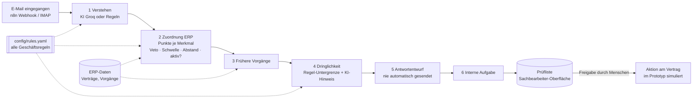

# Architektur – Komponenten und Datenfluss

## In einem Satz
Eine E-Mail läuft durch **sechs feste Schritte**. Die **KI liest** nur (Art, Fakten, Hinweis auf Dringlichkeit). **Entscheiden** tun feste, nachvollziehbare Regeln. **Handeln** darf nur ein Mensch nach Freigabe.

## Datenfluss

## Komponenten

| Komponente | Aufgabe | Technik | Warum so |
|---|---|---|---|
| n8n-Workflow | sichtbarer Prozess: ein Knoten pro Schritt, Verzweigung nach Status/Notfall | n8n 2.x (selbst gehostet, EU-tauglich) | Fachbereich sieht den Ablauf; n8n **leitet nur weiter**, entscheidet nichts |
| Pipeline-Dienst | die sechs Schritte als einzelne, testbare Funktionen | Python 3.12, FastAPI, Pydantic | jeder Schritt einzeln aufrufbar (n8n) und als Ganzes (`/api/process`) – ein Test garantiert gleiche Ergebnisse |
| Leser (Provider) | E-Mail → Art, Fakten, Dringlichkeitshinweis | Groq (`openai/gpt-oss-120b`, strenges JSON-Schema) **oder** Regelmodus ohne Schlüssel | austauschbar; bei Fehler automatisch Regelmodus |
| Zuordnung | Vertrag/Einheit finden, Unsicherheit bewerten | deterministisch, `rapidfuzz` für Namen | darf nie „raten“; jede Entscheidung mit Begründung |
| Regeln | Schwellen, Gewichte, Schlüsselwörter, Fristen | `config/rules.yaml` | Fachregel ändern = eine Zeile ändern |
| ERP-Anbindung | Verträge, Objekte, Vorgänge lesen | Schnittstelle `ERPConnector`, im Prototyp JSON | echtes ERP später austauschbar, schreibt nur nach Freigabe |
| Sachbearbeiter-Oberfläche | Prüfliste, Begründungen, Freigabe, Protokoll | HTML/CSS/JS, von FastAPI ausgeliefert | ohne Build-Schritt, läuft offline |
| Aktions-Prüfung + Protokoll | einzige Stelle, die handeln darf | `actions.execute` + Audit-Log (JSONL) | ohne Freigabe keine Aktion am Vertrag |

## Schutz vor veralteten oder veränderten Vorschlägen
- **Stand wird festgehalten:** Jeder Vorgang merkt sich, mit welchen Regeln und welchen ERP-Daten er geprüft wurde. Ändert sich eins davon, ist eine Freigabe nicht mehr möglich. Der Vorgang wird neu verarbeitet, frühere Freigaben gelten nicht mehr.
- **Siegel des Servers:** Jeder Vorschlag bekommt ein digitales Siegel (HMAC). Ein geänderter Vorschlag (z. B. anderer Vertrag, anderer Status) wird nicht angenommen.
- **Feste Reihenfolge:** Die sechs Schritte laufen genau einmal und in dieser Reihenfolge. Nur fertig verarbeitete Vorgänge kommen in die Prüfliste.
- **Unklare Orte:** Mehrere oder verneinte Angaben („2. bzw. 3. OG“, „nicht links“, „12–14“) sind nie eindeutig → „Prüfung nötig“.
