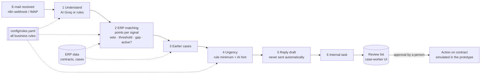

# Architecture – components and data flow

*English version of [../02_Architektur.md](../02_Architektur.md).*

## In one sentence
An e-mail passes through **six fixed steps**. The **AI reads** only (type, facts, urgency hint). Fixed, traceable rules **decide**. Only a person **acts**, after approval.

## Data flow

## Components

| Component | Job | Technology | Why |
|---|---|---|---|
| n8n workflow | visible process: one node per step, branching on status/emergency | n8n 2.x (self-hosted, EU-friendly) | the business sees the flow; n8n **only routes**, decides nothing |
| Pipeline service | the six steps as separate, testable functions | Python 3.12, FastAPI, Pydantic | each step callable on its own (n8n) and as a whole (`/api/process`) – a test guarantees identical results |
| Reader (provider) | e-mail → type, facts, urgency hint | Groq (`openai/gpt-oss-120b`, strict JSON schema) **or** rule mode without a key | swappable; automatic rule mode on errors |
| Matching | find contract/unit, rate uncertainty | deterministic, `rapidfuzz` for names | never "guesses"; every decision with a reason |
| Rules | thresholds, weights, keywords, deadlines | `config/rules.yaml` | change a business rule = change one line |
| ERP connector | read contracts, buildings, cases | `ERPConnector` interface, JSON in the prototype | real ERP can be plugged in later; writes only after approval |
| Case-worker UI | review list, reasons, approval, audit log; German / English | HTML/CSS/JS served by FastAPI | no build step, runs offline |
| Translation | every system text German → English | deterministic patterns (`i18n.py`), `/api/translate` | English for non-German readers without an LLM |
| Action check + audit log | the only place allowed to act | `actions.execute` + audit log (JSONL) | no contract action without approval |

## Protection against outdated or edited proposals
- **Basis is recorded:** every case remembers which rules and which ERP data it was checked with. If either changes, approval is no longer possible; the case is processed again and earlier approvals no longer count.
- **Server seal:** every proposal carries a digital seal (HMAC). An edited proposal (e.g. another contract or status) is refused.
- **Fixed order:** the six steps run exactly once and in order. Only completely processed cases enter the review list.
- **Unclear places:** several or negated details ("2. bzw. 3. OG", "nicht links", "12–14") are never definite → "review needed".
